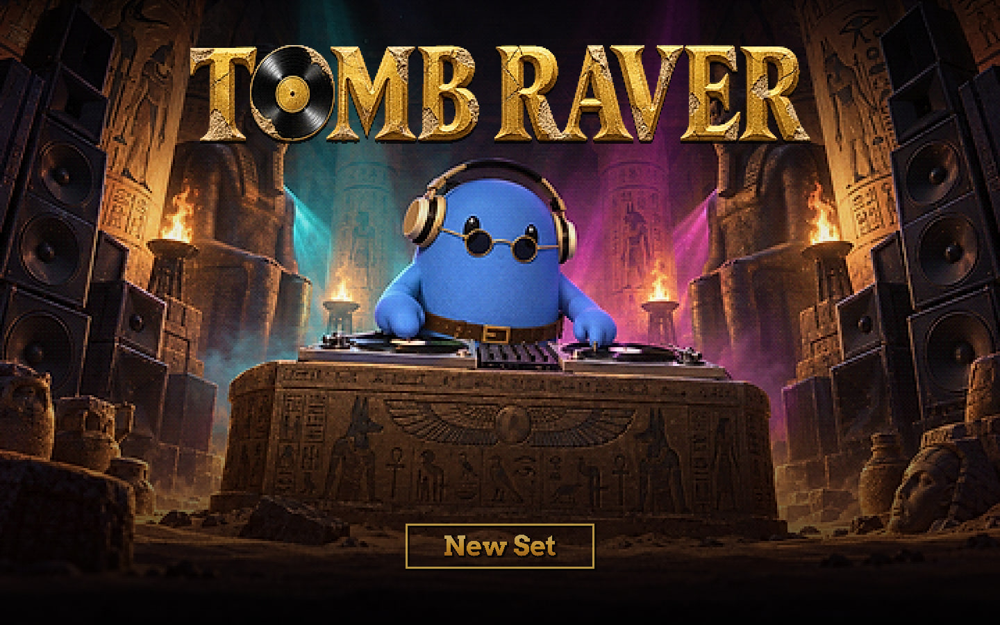
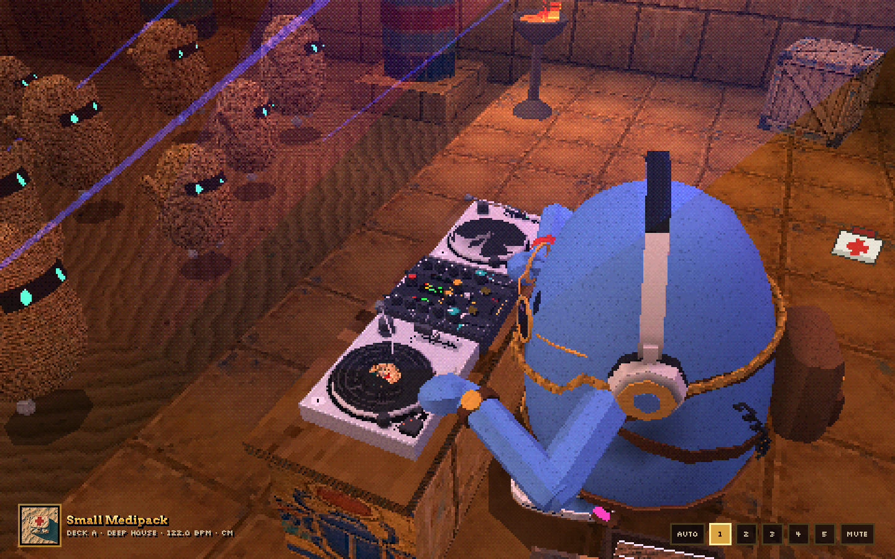
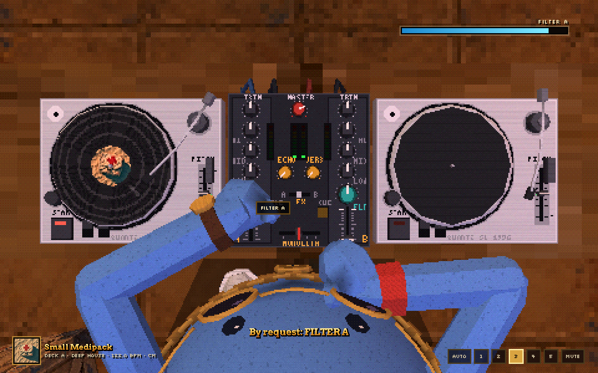
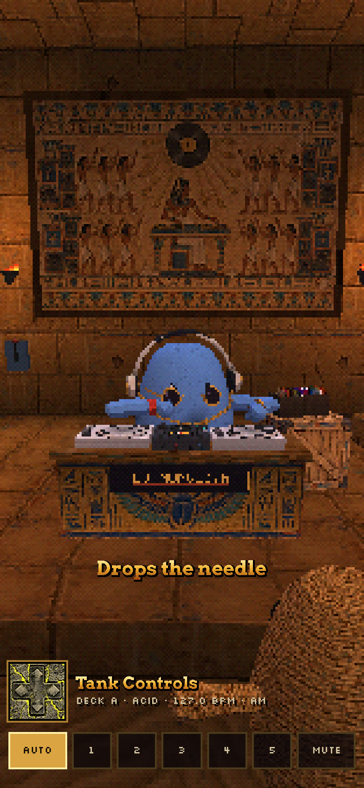

# TOMB RAVER

> The crowd has been dead for three thousand years and has never had a better night.

[](https://davidyen1124.github.io/tomb-raver/)

**Doors are open: <https://davidyen1124.github.io/tomb-raver/>**

Sound on. There is no cover charge and no closing time.

Fan-made and unofficial: not affiliated with Turnstone, nor with any game or its makers. The name is a pun and the look is a homage; the model, the pictures and the music are original to this project.

## What is this?

A [Turnstone](https://myturnstone.ai) Pebble, under the name **DJ MONOLITH**, plays an endless set on two turntables and a mixer, on a sarcophagus, in a burial chamber, to a crowd of small mummies. It looks the way a PlayStation drew a tomb in 1996.

There are no audio files in this repository. Every kick, clap and piano is built in the browser while it plays, and the mixing is done live by a blue egg in mittens.

The one rule of the page: **a control moves only while one of his fingertips is on it, and the sound follows the control.** Nothing in the music changes by itself. When the bass goes, it is because a mitten is on a LOW knob, turning it.

| The poster | The venue |
|---|---|
|  |  |

Every picture in this README is a screenshot of the page. The first one only looks like concept art because the title screen is a painting. After you press the button, it is 1996.

## How to attend

1. Press **New Set**. It has to be a press: browsers do not let a page make a sound until somebody asks. While the room loads, a thin dark red bar runs along the foot of the picture; when it is ready the button appears.
2. He pulls a record out of the box, puts it on, drops the needle, opens the channel and lets go on the first beat. From then on it does not stop. About every three minutes there is a mix, and between mixes he works the record that is playing.
3. Read the gold type. It says what he is doing while he does it: *Takes half the low out of B. Swaps the basses on the one. One arm in the air.*
4. Ask for something. Press any knob or fader on the desk and drag. His nearer hand drops what it is doing, goes there and turns it, and you hear it. Let go and, a few seconds later, he puts it back where he had it.
5. Press start/stop on the playing deck and the record winds down. He starts it again. Try it during a mix and you get *Not now: two records are running*.

| Key | What it does |
|---|---|
| `1` | Camera over his shoulder, the way that game followed its raider |
| `2` | Camera on the floor |
| `3` | Camera straight down on the desk |
| `4` | Camera along the decks |
| `5` | Camera at the door |
| `A` | The director chooses, and cuts on the phrase |
| `M` | Mute. He carries on regardless |

Drag the picture to look round, scroll to move in. On a phone the same seven buttons run along the foot of the screen, and three of the cameras stand somewhere else so that he and the whole desk still fit. The camera is cut from one position to another; it never zooms with the music.

On screen there is almost nothing, as in the game. A thin bar, top right, appears while a control is being turned and shows how far (orange when it is his idea, blue when it is yours). The sleeve of the record on each deck sits bottom left. A record coming out of the box shows in the corner the way a pickup did. The pointer is his own hand: open as it moves about, about to pinch over anything that can be pressed or turned, closed while it holds.

| `1`, over his shoulder | `3`, with a request in |
|---|---|
|  |  |

<p align="center">
  
</p>

## The record box

Ten records, none of them recorded. Each is a small program that knows its style, key and arrangement (intro, two verses, a breakdown, a drop, an outro: the shape that makes a record mixable) and writes itself out one sixteenth-note at a time when a deck asks. Each time a record comes out of the box it is a new pressing: other riffs, and a key chosen to sit with the record it will be mixed into.

| Record | Style | BPM |
|---|---|---|
| Small Medipack | deep house | 122 |
| Swan Dive | filter house | 124 |
| Secret Found | piano house | 126 |
| Tank Controls | acid | 127 |
| Pushable Block | dub techno | 129 |
| Pull The Lever | techno | 131 |
| Save Crystal | trance | 132 |
| Butler In The Freezer | garage | 132 |
| Lost Valley | breaks | 135 |
| Rolling Boulder | jungle | 165 |

## FAQ

**Where are the audio files?**
There are none. No samples and no recordings: every sound is built in the browser from oscillators, noise and filters. The repository holds zero seconds of music and will play it until you close the tab.

**When does the set end?**
It does not. Hide the tab and nothing is drawn, but he goes on mixing.

**Is he really mixing, or is that an animation over a playlist?**
He is really mixing. One file is allowed to change a control ([`src/dj/hands.js`](src/dj/hands.js)), and only while a fingertip is within five centimetres of it. The lamps on the mixer follow the real signal. If you hold a knob until he runs out of time, he comes back later and puts right whatever was left in the wrong place.

**Can I pick up the medipack? Save at the crystal? Pull the lever?**
No. They are scenery; nothing happens if you press them.

**Why does it look like that?**
It is 1996 in there: about 360 lines of picture, vertices snapped to whole pixels, textures that swim, fifteen-bit colour, thirty frames a second. All of it is on purpose, including the swimming.

**My phone is on silent and it played anyway.**
Yes. The page tells the phone that this is music, not a ringtone (`navigator.audioSession`, iOS 17 on; on an older iPhone a silent `<audio>` element looping alongside makes the same point). Worth knowing before you open it in a meeting.

**The room went dim and a gold button says "Tap for sound".**
The browser is holding the sound back. None will let a page play before it has been touched, and a phone can take the sound away again when the page is put aside. Press anything. The music comes back where it left off.

**Who drew the pictures?**
Nobody here can draw. The image model in Codex CLI did, from written briefs. See [Where things came from](#where-things-came-from).

## What's inside

### The music

Every sound comes from [`src/audio/voices.js`](src/audio/voices.js): kicks, hats made from the six square waves a drum machine makes cymbals from, claps, a two-operator electric piano, a rompler piano, drawbar organ, the silver acid box with its slides and accents, a Reese bass, a hoover, vowel filters that sing, a choir, a harp.

The record box is [`src/audio/records.js`](src/audio/records.js). A deck ([`src/audio/deck.js`](src/audio/deck.js)) plays its record at the speed its pitch fader says (eight per cent either way), with its own echo and room pressed into the groove, surface noise, and a platter that winds down audibly if it is stopped with the channel open.

The mixer ([`src/audio/mixer.js`](src/audio/mixer.js)) is what the knobs are wired to:

- **TRIM**: twelve decibels either way.
- **HI / MID / LOW**: a three-band isolator (Linkwitz-Riley splits at 250 Hz and 2.5 kHz). Fully down is silence in that band, noon is flat, fully up is six decibels more.
- **FILTER**: one knob, two filters. Left of noon a low-pass comes down, right of noon a high-pass goes up, with a little resonance.
- **Channel fader, crossfader, MASTER.**
- **ECHO** (one beat, fed back through a narrowing band) and **REVERB**, with a switch that points them at A, at B or at both. They listen after the fader, so a channel can be shut and its echo left ringing.
- **CUE**: whatever is cued leaks out thin and to one side, the way a headphone does when one cup is off.
- **Meters** that are real: the lamps on the model follow the signal in each channel.

### How he mixes

He does it the way the tutorials teach it (see [References](#references)):

1. The new record is cued with **half its low taken out** and its mid and top trimmed a little, the pitch fader moved until the tempos match, the channel in the headphones.
2. **Sixteen bars before the change, on a phrase, he lets go of it.** Eight bars with a hand on a headphone cup and a finger going to the platter's rim.
3. **Eight bars bringing its fader up** underneath the end of the old record's phrase.
4. **On the one, the basses are swapped**: two hands side by side, one on each LOW knob, turning opposite ways.
5. Then one of three exits: a **long blend** (the old record's top comes off, a filter sweeps it away, the fader follows); **out by the one** (its mid rolled out early, gone on beat one); or an **echo out** (low cut first, echo up, fader shut, the echo left to carry on alone).
6. A record too far off in tempo to blend (the jungle one, either way) gets the fourth: the old record wound up with the filter, thrown into the echo, and the new one dropped clean on the one.
7. The old record is stopped, lifted off and filed, and its channel set back to noon.

Between mixes: a reverb opened in the breakdown, the filter wound up through a build and let go on the drop, an echo thrown on the last beat of a phrase, a deck eased back to the speed it was cut at. A beat or two after a drop, one arm goes up; the other hand stays on the desk.

[`src/dj/brain.js`](src/dj/brain.js) writes these plans, in bars, against the clock of whichever record is playing. [`src/dj/hands.js`](src/dj/hands.js) carries them out: it decides which hand goes where, and it is the only code that ever changes a control.

### The look

**Tomb Raider on a PlayStation, 1996.** Taken from longplays of the game (see [References](#references)):

- **A world made of two-metre blocks**, one small picture per face, seams where they meet.
- **Light baked into the vertices**: uneven, warm round the torches, dark a few blocks away.
- **The console's own arithmetic**: about 360 lines of picture scaled up with hard edges, vertices snapped to whole pixels, textures stretched flat across each triangle so they swim, fifteen-bit colour with an ordered dither, thirty frames a second.
- **Characters made of rigid pieces.** Each of his arms is an upper arm, a forearm and a mitten, stood up every frame by two-bone arithmetic ([`src/dj/puppet.js`](src/dj/puppet.js)), with a little rubber in them for the far corners of the booth. The shoulders are above the tops of the decks and the elbows are carried out to the side, so an arm goes over the gear and never through it.
- **Set dressing from the game**: a saturated blue-violet save crystal floating in an otherwise ochre room, a small medipack that is a flat sprite and turns to face you, a lever on the wall.
- **Gold-to-orange slab type**, centred, with a hard shadow; a dark red loading bar along the bottom of a still; no permanent display, one thin bar that comes and goes.

He wears what a raider would: round dark glasses, a small backpack, a belt. Where the pistols would be, a pair of glow sticks. The headphone cable hangs down his back like a braid. Round his neck, a heavy gold chain of real links, with a gold record hanging from it.

The loudspeakers stand against the wall behind him, either side of the painting, and the columns stand against the side walls: nothing tall is in the middle of the room.

### Where things came from

**Pictures: the image model in Codex CLI.** [`scripts/gen.mjs`](scripts/gen.mjs) runs one `codex exec` per picture (its built-in `image_gen` tool, through the imagegen skill) from the briefs in [`assets-src/art/manifest.mjs`](assets-src/art/manifest.mjs): the walls, floor and sand, the painted column, the sarcophagus, the door, the mummy wrappings, the loudspeaker, the crate, the wall painting behind the booth (a figure in headphones at two turntables, under a sun that is a record), a rave flyer, ten record sleeves, the title picture, the title lettering, and his hand three times over for the pointer (each drawn from the one before, so that it is the same hand closing). The 29 originals are in [`assets-src/art/raw/`](assets-src/art/raw). [`scripts/textures.mjs`](scripts/textures.mjs) cuts them down to what a console would have given them (a wall is 64 pixels square) and packs them, with the faceplates and lamps it draws itself pixel by pixel, into one 1024 x 512 sheet, like a console's texture page.

**The model: Blender, by script.** [`assets-src/blender/build_tomb.py`](assets-src/blender/build_tomb.py) builds the chamber, the booth, the gear and the DJ out of lathes, lofts and boxes (`kit.py`, beside it), bakes firelight and ambient occlusion into the vertex colours by casting rays, and exports one GLB: 78 objects, about 8,300 triangles. Every knob, fader, platter, tonearm, lamp, arm segment, flame and woofer is its own object with its pivot where it turns. Where the controls are is written once, in [`src/dj/layout.json`](src/dj/layout.json), and read by the script that prints the faceplates, the script that builds the gear, and the page.

**How a DJ stands and what a mix is: YouTube.** See [References](#references).

## Run it locally

```sh
npm install
npm run dev          # http://localhost:5173
npm run build        # static site in dist/
```

URL flags: `?seed=7` plays the same set every time, `?bar=45` starts the first record that many bars in, `?cam=top` starts on one camera and stays there, `?go` starts the set without being asked (the browser may then want one press before it lets the sound out), and `?fps60` draws sixty frames a second for anyone who was not there in 1996.

The pictures and the model are committed, so none of this is needed to run the site:

```sh
npm run gen          # draw whatever is missing in assets-src/art/raw (needs a logged-in Codex CLI)
npm run model        # textures, then Blender with no window -> public/models/tomb.glb
npm run meta         # favicon, app icons, og.jpg, photographed from the page itself
```

`npm run model` expects Blender at `/Applications/Blender.app`.

## Checking it

Nobody can listen to an endless set to see whether it is right, or drag five cameras through every angle to see whether a column is in the way, so scripts do it, with Playwright.

```sh
npm run listen -- solo all       # every record start to finish, rendered offline; loudness and balance per section
npm run listen -- knobs crystal  # one record with each control worked in turn: what each does to each band
npm run listen -- set 9 7        # nine minutes of his own set (seed 7): everything he did, by the clock
npm run look -- qa/live "8,30,60"  # opens the page, starts the set, photographs it at those seconds
npm run poke                     # plays the visitor: drags knobs, presses stop, checks he puts them back
npm run check                    # every camera at every corner of its range; every hand on everything it touches
npm run angles                   # photographs the same camera positions, one sheet per camera, for looking at
npm run steady -- auto           # watches the camera through a drop: the lens may not move with the music
```

- **`listen`** renders on an offline audio context, many times faster than real time, with the brain and the hands running against a ghost of the stage. It writes a WAV and a spectrogram to `qa/audio/` and prints levels in four bands.
- **`poke`** checks that when a knob is dragged a fingertip is on it, its value has changed, and the band it governs has moved. It then takes the sound away in the middle of the set, and separately starts the set in a browser that allows no sound before a touch, and checks both times that the prompt appears and that one click or tap brings the music back.
- **`steady`** watches the camera's lens on every frame through a drop and the loud bars after it: within one camera position it must not change at all.
- **`check`, sight**: for each of the five cameras, at 105 positions across the whole of the range it can be dragged, tipped and moved through (and at a desktop, a widescreen and a phone window), it casts a ray to twenty-four points on the DJ and the gear and a grid of rays across the picture. It fails if a column, a loudspeaker, a brazier, a crate, the record box or the crowd hides any of those points, if anything tall stands in the foreground, or if, as a camera is cut to, any part of him, either hand or any corner of the gear is outside the picture. The limits in [`src/webgl/stage.js`](src/webgl/stage.js) are the widest that pass.
- **`check`, arms**: it puts each hand on each of the 34 things a hand ever touches, holds it there through several beats at full energy, and measures the least distance from every part of both arms, both hands and the belly to the table, the mixer, the decks and the records. Below zero would be inside the gear; the least it finds is about two centimetres clear.

## Where things live

```
index.html              the page; the first paint is the title itself, with a red bar while it loads
dev.html, listen.html   two benches for npm run dev: the picture alone, and the sound alone. Not built or deployed
vite.config.js          a relative base, so the build works under any path
src/
  main.js               boot, title, the loop, the director, the little that is on screen, asking
  asset.js              the address of a file in public/, wherever the page is served from
  styles.css            type and layers
  cursor.css            the pointer (written by scripts/textures.mjs)
  audio/voices.js       every sound, from oscillators, noise and filters
  audio/records.js      the record box: ten styles, each writing itself out a sixteenth at a time
  audio/deck.js         a turntable, as far as the sound goes
  audio/mixer.js        channels, isolator, filter, faders, echo, reverb, master, meters
  audio/engine.js       two decks into a mixer; the list of controls
  dj/layout.json        where every control on the booth is, in metres
  dj/brain.js           what he knows: which record next, and each mix planned in bars
  dj/hands.js           two hands and a list of things to do with them; the only door to a control
  dj/desk.js            one number per control, handed to the sound and the picture together
  dj/puppet.js          his body: reach, lean, turn, bounce
  dj/ghost.js           a stage with no picture and a body with no shape, for rendering the set offline
  webgl/stage.js        the picture: shader, model, every moving part, cameras, lights, crowd
  webgl/atlas.json      where each picture is on the texture sheet (written by scripts/textures.mjs)
  dev.js, listen.js     the code behind the two benches
public/                 served as it is: the model, the title pictures, the sleeves, the pointer, the icons
scripts/                drawing, textures, icons, and the ways of checking
assets-src/
  art/                  the briefs (manifest.mjs) and the pictures drawn from them (raw/)
  blender/              the model's source, and the textures made for it (tex/)
docs/                   the pictures in this README, and REFERENCES.md
.github/workflows/      the deploy
```

## Deploying

Pushing to `main` runs [a GitHub Actions workflow](.github/workflows/pages.yml) that builds with Vite and publishes `dist/` to GitHub Pages. The build uses relative paths (`base: './'`), so it works under `/tomb-raver/` or anywhere else.

## References

81 videos were checked, frames from 22 of them looked at and the subtitles of 20 read; the list, and what was taken from each, is in [`docs/REFERENCES.md`](docs/REFERENCES.md). The ones the page leans on most:

| For | Video | Channel |
|---|---|---|
| Hands, posture, a vinyl booth with the crate behind | [Interplanetary Criminal, HÖR, Jun 27 2022](https://youtu.be/96qhgQMtX2c) | HÖR BERLIN |
| Two hands on two EQ knobs, from a mixer camera | [DJ EZ classic UK Garage set in The Lab LDN](https://youtu.be/NFJIbNIAABo) | Mixmag |
| The hunched two-hand stance, the fist pump | [Len Faki Boiler Room Berlin DJ Set](https://youtu.be/jQRI3b2SX8c) | Boiler Room |
| Where hands rest between moves | [Jeff Mills, "Exhibitionist Mix"](https://youtu.be/cCpHiWwA2Rg) | TOP DJ ROOM |
| Technics and a Xone from above and behind | [MiX ROOM #24, Vinyl DJ Set](https://youtu.be/KSYfck7DRWE) | MiX ROOM |
| The straight-down camera | [Back to Basics Ep3, Vinyl Only Mix](https://youtu.be/SocOQlmFAiw) | Crossfader |
| The sixteen-bar blend and when to swap the basses | [2 DJ Transition Styles and When to Swap Your Basses](https://youtu.be/C-5qFyU9QNU) | Club Ready DJ School |
| Half the low out, EQ only while two records overlap | [5 DJ EQ Techniques That Instantly Improve Your Mixes](https://youtu.be/z0mFNt1ZTBw) | Club Ready DJ School |
| Centre is off; the wind-up through a build | [5 Ways to Use Filter FX in your DJ Sets](https://youtu.be/fpnO6-y4VlI) | Club Ready DJ School |
| Low cut first, one beat, about half depth | [How to Improve Your Echo Out Transitions](https://youtu.be/tkwM9vCmIbg) | DJcityTV |
| Trims at noon, peaks only touching red | [DJ Sound Levels Every DJ Must Know!](https://youtu.be/OxEJnKtSPcI) | Club Ready DJ School |
| Holding a record on its first beat, the push, the rim | [Beatmatching on Vinyl: Complete Turntable Mixing Guide](https://youtu.be/mpa_xy_yg4k) | DJ Blakey |
| What each knob on a club mixer does | [Pioneer DJM-900NXS2 Talkthrough Video](https://youtu.be/FEz_hUwwmj4) | Digital DJ Tips |
| The camera, the bar, the type, the crystal | [PSX Longplay [019] Tomb Raider](https://youtu.be/LCO8R_qZ-cA) | World-of-Longplays |
| The Egyptian palette | [Tomb Raider (PS1), Level 10: City of Khamoon](https://youtu.be/Hbl1584vzAo) | Eldincy |
| Affine warp, dither, thirty frames a second | [DF Retro: Tomb Raider Analysed](https://youtu.be/VutzIK3DqZE) | Digital Foundry |

No video, frame or sound from any of them is in the project: they were watched, not used.
